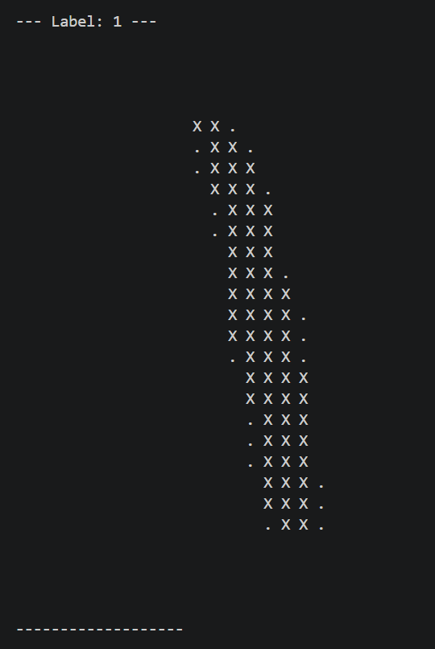
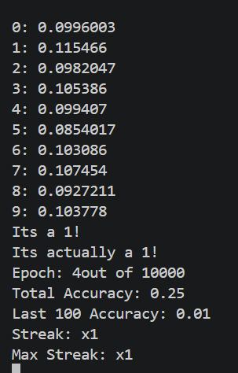

# MNIST Number Recognizer (C++ from scratch)

A handwritten digit recognizer built in plain C++ with **no machine learning libraries**. It implements a fully connected neural network, the forward pass, and backpropagation with mini-batch gradient descent by hand, and trains on the [MNIST](http://yann.lecun.com/exdb/mnist/) dataset in CSV form.

After every training epoch, the program picks a random image from the test set, draws it as ASCII art in the terminal, shows the network's output for each digit, and updates live accuracy stats.

## Example output

The program draws the test digit in the console:



then prints the activation of each output neuron (0 to 9), the network's guess, and the running stats:



## Features

- Fully connected feed-forward network with configurable layer sizes
- Sigmoid activation on every neuron
- Xavier/Glorot-style weight initialization (normal distribution)
- Backpropagation implemented manually, with gradients accumulated over a mini-batch and then averaged
- Live ASCII rendering of the 28x28 test image
- Live stats: total accuracy, last-100 accuracy, current streak, and max streak

## Network architecture

| Layer | Neurons | Role |
|-------|---------|------|
| 0 | 784 | Input (28x28 pixels, scaled to 0 to 1) |
| 1 | 512 | Hidden |
| 2 | 256 | Hidden |
| 3 | 128 | Hidden |
| 4 | 10 | Hidden |
| 5 | 10 | Output (one neuron per digit 0 to 9) |

The predicted digit is the output neuron with the highest activation. Layer sizes are set in `main()` with the `network.emplace_back(...)` calls.

## The math

For each neuron, with previous-layer activations `a_i`, weights `w_i`, and bias `b`:

```
z = sum(w_i * a_i) + b
a = sigmoid(z) = 1 / (1 + e^-z)
```

**Cost** for one training example (sum over the 10 outputs, `y` is the one-hot target):

```
C = sum_j (a_j - y_j)^2
```

**Backpropagation** uses the chain rule, with `sigmoid'(z) = a(1 - a)`:

```
dC/da (output layer)  = 2 (a - y)
dC/da (hidden layers) = sum over next-layer neurons of  (dC/da_next * a_next(1 - a_next) * w)

dC/dw = dC/da * a(1 - a) * a_prev
dC/db = dC/da * a(1 - a)
```

Each example's `dC/dw` and `dC/db` are added to per-weight and per-bias accumulators. At the end of a mini-batch, the accumulators are divided by the number of examples and the parameters take a gradient descent step:

```
w <- w - learningRate * (accumulated dC/dw / batchExamples)
b <- b - learningRate * (accumulated dC/db / batchExamples)
```

## Code overview

| Piece | What it does |
|-------|--------------|
| `getData()` | Loads a CSV file (skips the header row, label in the first column, then 784 pixel values) |
| `Connection` | A weight plus a pointer to the previous-layer neuron it comes from, with random initialization |
| `Neuron` | Holds its activation, bias, incoming connections, and gradient accumulators |
| `Layer` | A vector of neurons |
| `calculateNetwork()` | Forward pass through every layer |
| `calcAcc()` | Backward pass for one layer: accumulates weight/bias gradients and propagates `dC/da` to the previous layer |
| `printMNISTImage()` | Draws a 28x28 image in the terminal (`X` = bright pixel, `.` = faint, blank = background) |
| `printFinalLayer()` | Prints each output activation and returns the predicted digit |

## Training settings

Set in `main()`:

| Variable | Default | Meaning |
|----------|---------|---------|
| `epochCount` | 10000 | Number of epochs to run |
| `batchSize` | 32 | Number of mini-batches per epoch |
| `trainingExamples` | 200 | Examples per mini-batch |
| `learningRate` | 0.1 | Gradient descent step size |

## Getting started

### Requirements

- A C++20 compiler (developed with Clang++ from MSYS2 UCRT64 on Windows)
- The MNIST dataset in CSV format (`mnist_train.csv` and `mnist_test.csv`)

### Dataset

Each CSV file should have one header row, then one row per image: the label (0 to 9) followed by 784 pixel values (0 to 255). Put both files in a `res/` folder next to the folder you run the program from. The program looks for:

```
../res/mnist_train.csv
../res/mnist_test.csv
```

Example layout:

```
project/
├── res/
│   ├── mnist_train.csv
│   └── mnist_test.csv
└── src/
    └── main.cpp
```

Run the executable from inside `src/` so the `../res/` paths resolve.

### Build

From the command line:

```
clang++ -std=c++20 -O2 main.cpp -o main.exe
```

Or in VS Code, use the included `tasks.json` build task ("Build with clang++"), which compiles the open file with `-std=c++20 -g` using `C:/msys64/ucrt64/bin/clang++.exe`. Adjust the compiler path in `tasks.json` if your MSYS2 install is elsewhere. For faster training, add `-O2` to the task's `args` and drop `-g`.

### Run

```
./main.exe
```

Training prints a lot per epoch, so the first few epochs are a good way to confirm everything loads and the stats update.

## Reading the stats

| Stat | Meaning |
|------|---------|
| Total Accuracy | Fraction of epochs so far where the random test digit was guessed correctly |
| Last 100 Accuracy | Same, over the most recent 100 epochs |
| Streak | Current run of consecutive correct guesses |
| Max Streak | Longest run so far |

Early in training the network is effectively guessing, so all ten outputs sit near 0.1 and accuracy is around 10%.

## Known limitations and ideas

- **One test sample per epoch.** The displayed accuracy is based on a single random test image each epoch, so it is noisy. Evaluating on the full test set (or a larger random sample) would give a much more reliable number.
- **Same training data every epoch.** Each epoch trains on the first `batchSize * trainingExamples` rows (6,400 images by default) in the same order. Shuffling and iterating over all 60,000 images would use the full dataset.
- **Sigmoid + squared error learns slowly**, especially in deeper networks, because `a(1 - a)` shrinks gradients. ReLU hidden layers with a softmax + cross-entropy output are the usual next step.
- **Speed.** Neurons are stored as objects with pointer-linked connections, which is easy to read but slow. Flat weight matrices would be much faster.
- Save and load trained weights so training doesn't have to restart each run.

## Why this project

Written to understand neural networks end to end: the forward pass, the chain rule behind backpropagation, and gradient descent, without a framework hiding the details.
